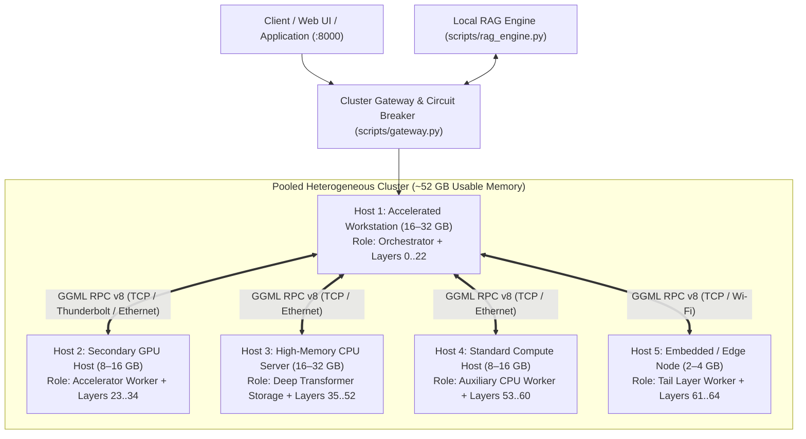

# Offline-AI-Cluster
### Universal Offline Distributed LLM Inference Cluster with Local RAG & Heterogeneous Tensor Splitting

[](LICENSE)
[](#cross-platform-setup-guides)
[](#offline-rag-architecture)

---

> [!NOTE]
> **Unified Master Repository**: This repository now integrates the complete high-performance Apple Silicon Thunderbolt Bridge architecture, dynamic VRAM injection, and exo sharding originally from `mac-ai-cluster`. All cross-platform cluster development (Windows, macOS, Linux, Edge) is permanently unified here.

## 1. Overview

**Offline-AI-Cluster** is a public, open-source framework engineered to aggregate arbitrary, heterogeneous consumer and workstation hardware into a **unified, air-gapped AI compute cluster with integrated local Retrieval-Augmented Generation (RAG)**.

By pooling available RAM and accelerators across machines running **macOS, Windows, diverse Linux distributions, and embedded edge devices**, this architecture allows you to run large language models (up to **32B and 70B** parameters) completely offline with zero external cloud subscriptions, zero telemetry, and zero data leaving your local network.

```
   ┌────────────────────────────────────────────────────────────────────────┐
   │                       Offline-AI-Cluster Mesh                          │
   │                                                                        │
   │  ┌──────────────────────┐  ┌──────────────────────┐  ┌──────────────┐  │
   │  │   Heterogeneous      │  │    Zero-Cloud        │  │  Resilient   │  │
   │  │   Tensor Splitting   │  │    Offline RAG       │  │  Failover    │  │
   │  │   (GGML RPC Engine)  │  │    (Local Embeddings)│  │  Gateway     │  │
   │  └──────────────────────┘  └──────────────────────┘  └──────────────┘  │
   └────────────────────────────────────────────────────────────────────────┘
```

---

## 2. Core Architectural Pillars

### 1. Heterogeneous Tensor Splitting (GGML RPC v8)
- Distribute model weights and KV caches across dissimilar architectures:
  - **Apple Silicon Metal** (M-Series unified memory bandwidth).
  - **NVIDIA CUDA / AMD ROCm** workstation GPUs.
  - **Standard x86_64 AVX2 / AVX-512** CPUs.
  - **ARM64 NEON** embedded processors (Raspberry Pi, SBCs, handheld consoles).
- Only the **Orchestrator node** requires the model file on disk; worker nodes allocate memory and execute tensor operations over TCP.

### 2. Zero-Cloud Local RAG Pipeline
- Fully local document ingestion, sliding-window chunking, and embedding generation via local GGUF models (e.g. `bge-small-en-v1.5`, `nomic-embed-text-v1.5`).
- Pure Python and SQLite cosine similarity index requiring zero cloud API keys and zero Docker container bloat.

### 3. Dynamic Circuit Breaker & Failover Gateway
- Multi-threaded reverse proxy (`scripts/gateway.py`) providing a unified OpenAI-compatible endpoint on port `8000`.
- Integrated UDP discovery beacon (`port 50050`) for instant auto-joining of worker nodes.
- Actively polls node heartbeats. If a worker disconnects (laptop sleep, battery depletion, or network packet drop), queries are automatically rerouted to surviving nodes in $<500\text{ ms}$.

### 4. Zero-Config Portable Auto-Discovery (Single-Binary + Single-Script)
- Drop `ggml-rpc-server` and `scripts/node_agent.py` onto **any** machine and run one command.
- The node inspects physical RAM directly via OS kernel calls, launches the backend, broadcasts across the LAN, and registers with the Orchestrator without manual IP or `--tensor-split` configuration. See **[docs/PORTABLE_AUTODISCOVERY.md](docs/PORTABLE_AUTODISCOVERY.md)**.

---

## 3. Reference Cluster Topology

An example heterogeneous deployment aggregating **~52 GB** of pooled memory across typical hardware tiers:



### Reference Node Tier Roles:
| Tier | Typical Memory | Preferred Compute Backend | Recommended Assigned Role |
|---|---|---|---|
| **Tier 1: Coordinator** | 16 GB to 64 GB | Metal / CUDA / ROCm | **Orchestrator + Initial Layers** |
| **Tier 2: GPU Worker** | 8 GB to 24 GB | Metal / CUDA | **Intermediate Dense Compute Layers** |
| **Tier 3: Bulk CPU Worker**| 16 GB to 64 GB | x86_64 AVX2 / AVX-512 | **Deep Feedforward Layer Storage** |
| **Tier 4: Standard Host** | 8 GB to 16 GB | x86_64 / ARM64 | **Auxiliary CPU Compute Layers** |
| **Tier 5: Edge / Embedded**| 2 GB to 4 GB | ARM64 NEON | **Tail Transformer Layers / Telemetry** |

---

## 4. Quickstart: Launching the Cluster

### Option A: 1-Click Automated Setup for Any New Machine (Recommended)

To set up a fresh PC from GitHub in 1 click:

#### On Windows:
```bat
git clone https://github.com/r0bledas/Offline-AI-Cluster.git
cd Offline-AI-Cluster
setup.bat
```
`setup.bat` automatically:
1. Initializes `cluster.config.json` from the dynamic template.
2. Downloads and unpacks official native `llama.cpp` binaries (`llama-server.exe`, `ggml-rpc-server.exe`, Vulkan/AVX2 DLLs).
3. Offers 1-click download of verified starter model (`Llama-3.2-1B-Instruct-Q4_K_M.gguf`, 807 MB).
4. Adds the `cluster` CLI command to your system `PATH`.
5. Creates a 1-click `Offline AI Cluster.bat` launcher on your Desktop.
6. Launches the interactive Multi-Node Hub.

#### On macOS & Linux:
```bash
git clone https://github.com/r0bledas/Offline-AI-Cluster.git
cd Offline-AI-Cluster
chmod +x setup.sh && ./setup.sh
```

---

### Option B: Unified Multi-Node CLI (`cluster`)

Once installed, use the unified `cluster` CLI from any directory:

```bat
# Check health, online ports, RAM, and telemetry across all nodes
cluster status

# Send an inference prompt to the cluster
cluster prompt "Explain distributed tensor parallelization in two sentences."

# Remotely start/stop worker daemons on all nodes (or a specific node index)
cluster worker-start
cluster worker-stop

# Execute a shell command remotely on any node
cluster exec 0 "systeminfo"

# Open Remote Desktop to a worker node with saved credentials
cluster rdp 0

# Check and hot-update binaries directly from upstream GitHub releases
cluster update
```

---

### Option C: Zero-Config Python Discovery Gateway
On the coordinator workstation:
```bash
python scripts/gateway.py
```

On any worker machine (macOS, Windows, or Linux):
```bash
python scripts/node_agent.py
```
The node automatically calculates available RAM via kernel primitives, starts `ggml-rpc-server`, broadcasts a UDP discovery beacon to port `50050`, and joins the cluster. The Gateway dynamically compiles the exact `--rpc` and `--tensor-split` flags for your model.

---

### Option B: Manual Static Launch
#### Step 1: Start Worker Nodes
On each worker machine, launch the `ggml-rpc-server` daemon:

```bash
# macOS Worker:
./build-metal/bin/ggml-rpc-server -H 0.0.0.0 -p 50052 -c

# Linux Worker (Debian, Arch, Fedora, Alpine):
./build-linux/bin/ggml-rpc-server -H 0.0.0.0 -p 50052 -c

# Windows Worker (MSVC / w64devkit):
build-win\bin\Release\ggml-rpc-server.exe -H 0.0.0.0 -p 50052 -c

# Embedded Edge Node (Raspberry Pi / Console):
./build-rpi/bin/ggml-rpc-server -H 0.0.0.0 -p 50052 -c
```

### Step 2: Start the Orchestrator
On the coordinator workstation, start `llama-server` pointing to the worker node IP addresses:

```bash
./llama-server \
  -m models/qwen2.5-32b-instruct-q4_k_m.gguf \
  --host 0.0.0.0 \
  --port 8080 \
  --rpc 192.168.1.101:50052,192.168.1.102:50052,192.168.1.103:50052,192.168.1.104:50052 \
  -ngl 99 \
  --tensor-split 16,16,8,8,4 \
  -c 4096
```

### Step 3: Start the Gateway & Query
```bash
python scripts/gateway.py
```
Send queries to `http://localhost:8000/v1/chat/completions` using any OpenAI-compatible client, web UI, or SDK.

---


---

## 4. Direct Updates Engine (eLlama-Style Automated Sync)

`Offline-AI-Cluster` features an automated, zero-dependency binary update engine inspired by `eLlama`'s `UpdateManager.cs`. It directly queries GitHub releases for upstream `llama.cpp`, detects your operating system and hardware accelerators (Vulkan, Apple Metal, or CPU AVX2), and upgrades binaries in-place without compiling from source:

```bash
# Check for latest upstream releases:
node scripts/updater.js --check
# or: python scripts/updater.py --check

# Upgrade binaries in-place (Windows):
scripts\update_llama_cpp.bat

# Upgrade binaries on macOS (Metal) or Linux:
./scripts/update_llama_cpp.sh
```

---

## 5. Cross-Platform Documentation Directory

Comprehensive, step-by-step compilation, firewall, and background daemon guides for every platform:

- **[Apple Silicon & Thunderbolt Guide](docs/platforms/APPLE_SILICON_THUNDERBOLT_GUIDE.md)**: Point-to-point Thunderbolt 3/4 (40 Gbps, <0.15ms latency) clustering for M-series Macs with dynamic `iogpu` VRAM headroom expansion.
- **[macOS Setup Guide](docs/DISTRIBUTED_TENSOR_SPLITTING.md#platform-a-macos)**: Apple Silicon Metal acceleration (`-DGGML_METAL=ON`), Homebrew prerequisites, point-to-point Thunderbolt 4 networking, and `launchd` background service configuration.
- **[Linux Setup Guide](docs/DISTRIBUTED_TENSOR_SPLITTING.md#platform-b-linux)**: Copy-paste instructions for Debian/Ubuntu, Arch Linux, Fedora/RHEL, openSUSE, Alpine Linux (musl libc), and `systemd` service units.
- **[Windows Setup Guide](docs/DISTRIBUTED_TENSOR_SPLITTING.md#platform-c-windows)**: Visual Studio 2022 Community (MSVC), zero-install `w64devkit`, WSL2 setup, NSSM service management, and Windows Defender Firewall rules.
- **[Embedded & Edge Guide](docs/DISTRIBUTED_TENSOR_SPLITTING.md#platform-d-embedded)**: ARM64 single-board computers (Raspberry Pi 4/5), NVIDIA Jetson (CUDA), and Nintendo Switch (Horizon OS / libnx via LlamaNX) with 512 MB memory chunking.

---

## 6. Offline RAG Pipeline

The local RAG engine (`scripts/rag_engine.py`) operates with 100% air-gapped isolation:

```bash
# 1. Ingest local documentation into the offline vector store:
python scripts/rag_engine.py ingest --dir ./knowledge_base

# 2. Query with top-k grounded context and source citations:
python scripts/rag_engine.py query "Explain the memory partitioning formula" --send
```

See **[docs/OFFLINE_RAG_ARCHITECTURE.md](docs/OFFLINE_RAG_ARCHITECTURE.md)** for vector math, chunking strategies, and hybrid search mechanics.

---

## 7. Repository Layout

```text
Offline-AI-Cluster/
├── README.md                           # Master architectural guide & quickstart
├── ROADMAP.md                          # 5-phase engineering roadmap
├── AGENTS.md                           # Autonomous AI agent coding guidelines & invariants
├── config/
│   └── cluster.json                    # Fleet configuration, node IPs, tensor weights & timeouts
├── scripts/
│   ├── gateway.py                      # Multi-threaded circuit breaker & UDP auto-discovery beacon
│   ├── node_agent.py                   # Portable single-script worker agent (zero pip dependencies)
│   ├── rag_engine.py                   # 100% offline RAG pipeline (chunking, embedding, retrieval)
│   ├── setup_macos.sh                  # One-click build script for macOS
│   ├── setup_linux.sh                  # One-click build script for Linux
│   └── setup_windows.bat               # One-click build script for Windows
├── docs/
│   ├── DISTRIBUTED_TENSOR_SPLITTING.md # Exhaustive cross-platform sharding manual
│   ├── PORTABLE_AUTODISCOVERY.md       # Zero-config auto-discovery protocol architecture
│   ├── OFFLINE_RAG_ARCHITECTURE.md     # In-depth local vector store & embedding specification
│   └── llama_cpp_manuals/              # 76 bundled offline upstream documentation manuals
└── examples/
    ├── ingest_sample.txt               # Sample local knowledge base document
    └── query_cluster.py                # Command-line query utility with RAG injection
```

---

## 8. License & Attribution

- Distributed under the **MIT License**.
- Built on the distributed compute primitives of [llama.cpp](https://github.com/ggml-org/llama.cpp) by Georgi Gerganov and contributors.
