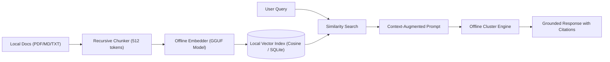

# Offline-AI-Cluster
### Universal Offline Distributed LLM Inference Cluster with Local RAG & Heterogeneous Tensor Splitting

[](LICENSE)
[](#cross-platform-setup-guides)
[](#offline-rag-architecture)

---

## 1. What is Offline-AI-Cluster?

**Offline-AI-Cluster** is a complete, self-contained architecture for aggregating disparate consumer hardware (Apple Silicon Macs, Windows laptops, Linux servers, and Nintendo Switch consoles) into a **unified private AI computing engine with integrated offline Retrieval-Augmented Generation (RAG)**.

No cloud APIs. No external subscriptions. No data leaving your local network.

### Key Capabilities
- **Heterogeneous Tensor Splitting**: Pool RAM across different architectures (x86_64, ARM64, Apple Silicon Metal) to load models up to **32B and 70B** parameters that cannot fit on any single device.
- **Zero-Cloud Offline RAG**: Ingest documents, extract text, embed using local GGUF models, index into a lightweight cosine vector store, and inject verified context into queries completely offline.
- **Fault-Tolerant Circuit Breaker**: An intelligent local reverse proxy monitors node heartbeats. If a laptop sleeps or an edge device drops, queries are rerouted in $<500\text{ ms}$ without user interruption.
- **Offline Documentation Archive**: Includes 76 bundled upstream `llama.cpp` manuals covering every backend, hardware acceleration target, and build instruction.

---

## 2. Fleet Architecture & Pooled Memory Math

Example heterogeneous deployment across a 5-node consumer fleet:


### Hardware Fleet Memory Table:
| Device | Physical RAM | Best Suited Role | Compute Backend |
|---|---|---|---|
| **MacBook Air M2** | **16 GB** Unified | **Cluster Orchestrator** | Metal GPU (~100 GB/s) |
| **ThinkPad T450** | **16 GB** DDR3 | **Bulk Layer Storage** | x86_64 AVX2 CPU |
| **MacBook Pro M2** | **8 GB** Unified | **Fast GPU Worker** | Metal GPU (~100 GB/s) |
| **ThinkPad T470** | **8 GB** DDR4 | **Auxiliary CPU Worker** | x86_64 AVX2 CPU |
| **Nintendo Switch** | **3.2 GB** LPDDR4 | **Edge Terminal / Tail Layers** | ARM64 Cortex-A57 (NEON) |
| **TOTAL FLEET** | **~51.2 GB** | **Mixed Accelerators** | **Runs 32B–70B Models!** |

---

## 3. Quickstart: 3-Step Cluster Launch

### Step 1: Start Worker Nodes
On each worker node, start the RPC server:

```bash
# macOS Worker:
./scripts/setup_macos.sh
./build-metal/bin/ggml-rpc-server -H 0.0.0.0 -p 50052 -c

# Windows Worker (ThinkPad T450/T470):
scripts\setup_windows.bat
build-win\bin\Release\ggml-rpc-server.exe -H 0.0.0.0 -p 50052 -c

# Linux Worker:
./scripts/setup_linux.sh
./build-linux/bin/ggml-rpc-server -H 0.0.0.0 -p 50052 -c

# Nintendo Switch:
Launch LlamaNX homebrew -> Press [X] to enter Distributed RPC Mode.
```

### Step 2: Start the Orchestrator
On the primary machine (e.g. MacBook Air M2), launch the model with tensor sharding:

```bash
./build-metal/bin/llama-server \
  -m models/qwen2.5-32b-instruct-q4_k_m.gguf \
  --host 0.0.0.0 \
  --port 8080 \
  --rpc 192.168.1.11:50052,192.168.1.12:50052,192.168.1.13:50052,192.168.1.14:50052 \
  -ngl 99 \
  --tensor-split 16,8,16,8,3 \
  -c 4096
```

### Step 3: Start the Fault-Tolerant Gateway & Local RAG
```bash
python scripts/gateway.py
```
Open your browser to `http://localhost:8000` to interact with the cluster!

---

## 4. Cross-Platform Setup Guides

Detailed, copy-paste build instructions for every platform:

- **[macOS Setup Guide](docs/DISTRIBUTED_TENSOR_SPLITTING.md#platform-a-macos)**: Xcode Command Line Tools, Homebrew, Apple Metal backend (`-DGGML_METAL=ON`), and high-speed Thunderbolt 4 Bridge networking.
- **[Windows Setup Guide](docs/DISTRIBUTED_TENSOR_SPLITTING.md#platform-b-windows)**: Visual Studio 2022 Community / MSVC, lightweight `w64devkit`, WSL2 instructions, and firewall configuration.
- **[Linux Setup Guide](docs/DISTRIBUTED_TENSOR_SPLITTING.md#platform-c-linux)**: Instructions for Debian/Ubuntu, Arch/Manjaro, Fedora/RHEL, openSUSE, and Alpine Linux (musl libc).
- **[Nintendo Switch Guide](docs/DISTRIBUTED_TENSOR_SPLITTING.md#platform-d-nintendo-switch)**: Horizon OS / libnx integration with LlamaNX, 512 MB buffer chunking, and Wi-Fi latency tuning.

---

## 5. Offline RAG (Retrieval-Augmented Generation)

The cluster includes an air-gapped RAG pipeline (`scripts/rag_engine.py`) designed for zero internet access:



### Using the Offline RAG Engine
1. **Ingest Documents**:
   ```bash
   python scripts/rag_engine.py ingest --dir ./my_documents
   ```
2. **Query with Augmented Knowledge**:
   ```bash
   python scripts/rag_engine.py query "Summarize our internal system architecture"
   ```

See **[docs/OFFLINE_RAG_ARCHITECTURE.md](docs/OFFLINE_RAG_ARCHITECTURE.md)** for detailed vector math, chunking strategies, and hybrid search mechanics.

---

## 6. Repository Layout

```text
Offline-AI-Cluster/
├── README.md                           # Master architectural guide & documentation
├── ROADMAP.md                          # 5-phase engineering roadmap
├── config/
│   └── cluster.json                    # Cluster node configuration & memory weights
├── scripts/
│   ├── gateway.py                      # Fault-tolerant circuit-breaker gateway
│   ├── rag_engine.py                   # Complete offline RAG indexing & retrieval pipeline
│   ├── setup_macos.sh                  # One-click build script for macOS
│   ├── setup_linux.sh                  # One-click build script for Linux
│   └── setup_windows.bat               # One-click build script for Windows
├── docs/
│   ├── DISTRIBUTED_TENSOR_SPLITTING.md # Deep dive on RPC tensor sharding & latency math
│   ├── OFFLINE_RAG_ARCHITECTURE.md     # In-depth local vector store & embedding guide
│   └── llama_cpp_manuals/              # 76 bundled offline upstream documentation manuals
└── examples/
    ├── ingest_sample.txt               # Sample document for testing local RAG
    └── query_cluster.py                # Command-line query utility with RAG injection
```

---

## 7. License & Credits

- Distributed under the **MIT License**.
- Built on the open-source foundations of [llama.cpp](https://github.com/ggml-org/llama.cpp) by Georgi Gerganov and contributors.
- Nintendo Switch edge node capabilities powered by [LlamaNX](https://github.com/r0bledas/LlamaNX).
