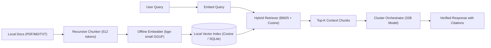
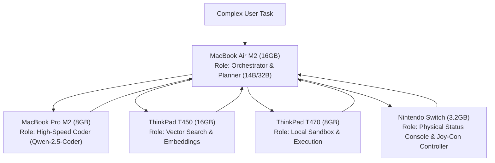

# Offline-AI-Cluster Roadmap
### From Air-Gapped Tensor Sharding to Fault-Tolerant Distributed RAG & Multi-Agent Swarms

---

## Vision Statement
**Offline-AI-Cluster** is engineered for environments where **zero external data leaves your local network**. Whether due to operational security, air-gapped field deployments, or privacy constraints, this project transforms an arbitrary collection of consumer hardware (Macs, PCs, Linux boxes, and embedded consoles) into a unified, resilient, private AI computing engine with integrated local knowledge retrieval (RAG).

```
   ┌────────────────────────────────────────────────────────────────────────┐
   │                       Offline-AI-Cluster Core                          │
   │                                                                        │
   │  ┌──────────────────────┐  ┌──────────────────────┐  ┌──────────────┐  │
   │  │   Heterogeneous      │  │    Zero-Cloud        │  │  Resilient   │  │
   │  │   Tensor Splitting   │  │    Offline RAG       │  │  Failover    │  │
   │  │   (GGML RPC Engine)  │  │    (Local Embeddings)│  │  Gateway     │  │
   │  └──────────────────────┘  └──────────────────────┘  └──────────────┘  │
   └────────────────────────────────────────────────────────────────────────┘
```

---

## Milestone 1: Heterogeneous Tensor Sharding Engine (Current Core)
*Goal: Pool disparate CPU, GPU, and ARM64 memory into a single virtual address space capable of running 32B–70B parameter models without cloud dependencies.*

- [x] **Cross-Platform RPC Protocol Standardization**:
  - Implement and document GGML RPC protocol v8 across macOS (Metal), Windows (MSVC/w64devkit), Linux (Debian, Arch, Fedora, Alpine), and Nintendo Switch (Horizon OS / libnx).
- [x] **Non-Contiguous Memory Chunking**:
  - Unconditional buffer splitting ($\le 512\text{ MB}$ chunks) to eliminate heap allocation ceilings on embedded/constrained kernels.
- [x] **Proportional Memory Scheduling**:
  - Dynamic calculation of `--tensor-split` weights based on live node memory reports (`RPC_CMD_GET_DEVICE_MEMORY`).
- [ ] **Automated mDNS / Zero-Config Peer Discovery**:
  - Implement Bonjour / Avahi mDNS daemon so worker nodes broadcasting `_ggml-rpc._tcp.local` are automatically discovered and aggregated by the Orchestrator without manual IP entry.
- [ ] **Dynamic Re-quantization On-the-Fly**:
  - Worker-specific quantization scaling (e.g., M2 Metal runs Q8/FP16 layers, ThinkPad CPUs run Q4_K_M, Switch runs IQ2/IQ3).

---

## Milestone 2: Low-Latency Transport & High-Speed Interconnects
*Goal: Overcome Wi-Fi latency bottlenecks to push token throughput beyond 15–20 tokens/sec across heterogeneous machines.*

- [x] **Local Disk Cache Persistence**:
  - Implement client-side disk caching (`-c` flag) storing hashed layer weights under local caches (`$HOME/.cache/llama.cpp/rpc`) to eliminate redundant multi-gigabyte network transfers on launch.
- [ ] **Dual-Tier Network Bridging (Thunderbolt 4 + Ethernet)**:
  - Configure direct point-to-point Thunderbolt 4 networking (20–40 Gbps, $<0.1\text{ ms}$ latency) between Apple Silicon nodes using `librdma` over Thunderbolt (Apple TN3205).
  - Bridge remaining CPU/Switch worker nodes over 1 Gbps / 2.5 Gbps Ethernet.
- [ ] **TCP Pipelining & Nagle's Algorithm Bypass**:
  - Enable `TCP_NODELAY` and tune socket buffer depths (`SO_RCVBUF`, `SO_SNDBUF` to $\ge 4\text{ MB}$) across all client sockets to prevent packet stall during activation vector back-propagation.
- [ ] **Async Tensor Streaming**:
  - Implement overlapping compute and transfer (double-buffering) so Node $N+1$ pre-fetches input activations while Node $N$ computes its final attention block.

---

## Milestone 3: Zero-Cloud Local RAG Pipeline (Architecture & Engine)
*Goal: Inject thousands of local documents (PDFs, Markdown, source code, manuals) into generation context using 100% offline embedding and vector similarity search.*



- [x] **Standalone Offline Embedding Engine**:
  - Support for local GGUF embedding models (`bge-small-en-v1.5`, `nomic-embed-text-v1.5`, `all-MiniLM-L6-v2`) running via local llama.cpp instance on port `8081`.
- [x] **Zero-Dependency Vector Store**:
  - Pure Python + NumPy/SQLite cosine similarity index requiring zero cloud API keys, zero Docker daemons, and zero external vector service subscriptions.
- [ ] **Hybrid Search (Lexical BM25 + Dense Semantic)**:
  - Reciprocal Rank Fusion (RRF) combining exact keyword hits (error codes, function names, serial numbers) with dense semantic search.
- [ ] **Local Document Parsing Suite**:
  - Offline parser for `.pdf`, `.docx`, `.md`, `.txt`, `.json`, `.csv`, and code repositories with AST-aware code chunking.
- [ ] **Context-Aware Reranking**:
  - Integrate local cross-encoder reranker model (`bge-reranker-base`) to score top-20 retrieved candidates down to the top-3 highest-relevance passages.

---

## Milestone 4: Fault Tolerance, Circuit Breaking & Self-Healing
*Goal: Ensure the cluster operates continuously ("faillessly") even when laptops sleep, batteries run low, or Wi-Fi packets drop.*

- [x] **Circuit-Breaking Reverse Proxy**:
  - Multi-threaded Python cluster gateway (`scripts/gateway.py`) with active heartbeat polling (`/api/status` & `/health`).
- [x] **Sub-Second Failover**:
  - In-flight request detection: If a worker node disconnects during generation, reroute the query to the highest-priority surviving node in $<500\text{ ms}$.
- [ ] **Graceful Node Eviction & Layer Rebalancing**:
  - Dynamic layer re-allocation: When worker node departure is detected, the Orchestrator recalculates `--tensor-split` without restarting the process.
- [ ] **Power-Aware Load Shedding**:
  - Monitor battery level and thermal throttling on mobile nodes (MacBook Air / Switch); dynamically offload compute to AC-powered desktop/ThinkPad nodes when battery drops below 20%.

---

## Milestone 5: Distributed Multi-Agent Swarm & Physical Consoles
*Goal: Evolve from simple Q&A inference into a cooperative multi-model swarm where each machine executes specialized roles.*



- [ ] **Role-Specialized Clustering**:
  - Assign dedicated models to nodes:
    - **Host 1 (MacBook Air M2)**: Reasoning & Planning (`Qwen-2.5-14B` or `Mistral-Small`).
    - **Host 2 (MacBook Pro M2)**: Fast Speculative Drafter / Coder (generates draft tokens at 40 t/s).
    - **Host 3 (ThinkPad T450)**: Permanent Vector Store & Document Ingestion worker.
    - **Host 4 (ThinkPad T470)**: Headless Tool execution sandbox.
    - **Host 5 (Nintendo Switch)**: Physical live dashboard displaying token velocity, cluster RAM graphs, and Joy-Con push-to-talk interrupt controls.
- [ ] **Speculative Distributed Decoding**:
  - Use the MacBook Pro M2 as the small draft model and the cluster-wide pooled model as the verifier, cutting overall generation latency by $2\times$ to $3\times$.

---

## Progress Tracker & Versioning
- **v0.1.0**: Heterogeneous GGML RPC architecture validation across macOS, Windows, Linux, Switch.
- **v0.2.0**: Zero-cloud RAG pipeline prototype (`scripts/rag_engine.py`) and offline gateway (`scripts/gateway.py`).
- **v0.3.0** (Next): mDNS discovery daemon and automatic `--tensor-split` negotiator.
- **v1.0.0**: Production-ready air-gapped distributed swarm with failover and live memory rebalancing.
