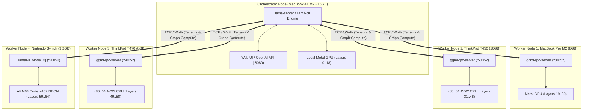
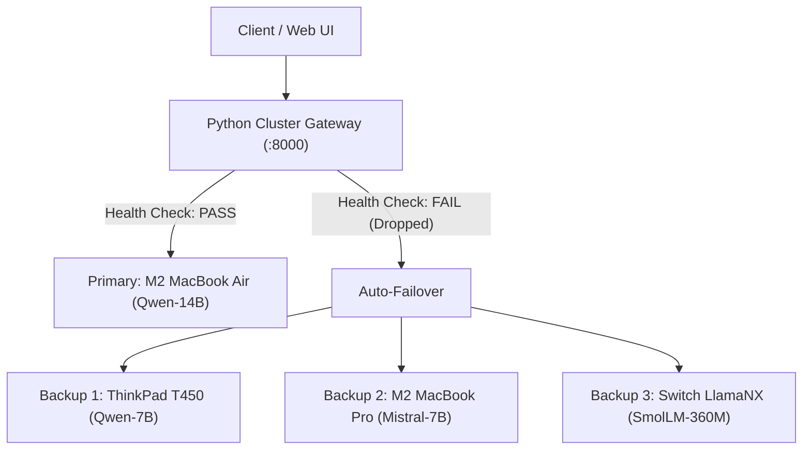

# The Universal Distributed LLM Orchestration & Offline Guide
### Multi-Platform Cluster Setup: macOS, Windows, Linux, and Nintendo Switch

---

## 1. Executive Architecture: How GGML / llama.cpp RPC Works

`llama.cpp` features a native, distributed compute and memory engine based on the **GGML RPC Protocol** (Protocol v8.0.1). Instead of requiring identical enterprise GPUs connected with NVLink, GGML RPC enables **heterogeneous compute and memory pooling** across consumer laptops, desktops, and embedded devices connected over a standard TCP/IP network.

### The Compute & Memory Topology


### How Tensor Sharding Operates
1. **Model Storage**: Only the **Orchestrator** needs the full `.gguf` file stored on disk. Worker nodes do **not** need the model file stored locally unless you enable local caching (`-c`).
2. **Buffer Allocation Handshake**:
   - The Orchestrator queries each worker's total and free RAM via RPC message `RPC_CMD_GET_DEVICE_MEMORY`.
   - The Orchestrator calculates layer distributions and instructs each worker to allocate backend buffers (`RPC_CMD_ALLOC_BUFFER`).
3. **Graph Execution**:
   - For every generated token, the Orchestrator builds the computation graph.
   - For layers assigned to a remote node, the node executes the tensor multiplication on its local CPU or GPU and returns the activation vectors back over TCP.

---

## 2. Your Fleet's Pooled Memory & Model Sizing

Across your specific hardware fleet:

| Device | Memory | Accelerator / Architecture | Proportion | Recommended Role |
|---|---|---|---|---|
| **MacBook Air M2** | **16 GB** Unified | 10-core Metal GPU (~100 GB/s) | 31% | **Orchestrator + Primary Fast Layers** |
| **ThinkPad T450** | **16 GB** DDR3 | Dual-channel x86 CPU | 31% | **Bulk Transformer Layers Storage** |
| **MacBook Pro M2** | **8 GB** Unified | 10-core Metal GPU (~100 GB/s) | 16% | **Secondary Metal Acceleration** |
| **ThinkPad T470** | **8 GB** DDR4 | Dual-channel x86 CPU | 16% | **Auxiliary CPU Layers** |
| **Nintendo Switch** | **3.2 GB** LPDDR4 | 4x ARM Cortex-A57 (NEON) | 6% | **Edge Terminal / Tail Layers** |
| **TOTAL FLEET** | **~51.2 GB** | **Mixed Metal + x86 + ARM64** | **100%** | **Capable of running 32B & 70B models!** |

### Models You Can Run on this 51 GB Pooled Cluster:
- **Qwen 2.5 32B Instruct (Q4_K_M)**: ~20.5 GB model weights + 4 GB KV cache = **24.5 GB total** (Leaves 26 GB of safety headroom).
- **DeepSeek-Coder-V2 16B Lite**: ~11 GB model weights (Runs blazingly fast across the two M2 Macs).
- **Llama 3.1 70B (IQ2_XS / IQ2_M)**: ~26–29 GB model weights + 6 GB KV cache = **~35 GB total** (Loads completely across your fleet).

---

## 3. Cross-Platform Build & Setup Guide

### Platform A: macOS (Apple Silicon M1/M2/M3/M4 & Intel)

macOS with Apple Silicon is the optimal Orchestrator because of unified memory and the Metal framework.

#### 1. Prerequisites
Open Terminal and install Xcode Command Line Tools and Homebrew:
```bash
xcode-select --install
/bin/bash -c "$(curl -fsSL https://raw.githubusercontent.com/Homebrew/install/HEAD/install.sh)"
brew install git cmake ninja
```

#### 2. Building `llama.cpp` with Metal & RPC
```bash
git clone --recursive https://github.com/ggml-org/llama.cpp.git
cd llama.cpp

# Configure CMake with Metal and RPC enabled
cmake -B build-metal -G Ninja \
  -DCMAKE_BUILD_TYPE=Release \
  -DGGML_METAL=ON \
  -DGGML_RPC=ON

# Build all targets (llama-server, llama-cli, ggml-rpc-server)
cmake --build build-metal --config Release -j$(sysctl -n hw.ncpu)
```

#### 3. Running as a Worker Node (MacBook Pro M2)
If using the second Mac as a compute node:
```bash
./build-metal/bin/ggml-rpc-server -p 50052 -H 0.0.0.0 -c
```
> [!TIP]
> The `-c` flag enables disk caching of model weights under `~/Library/Caches/rpc/`. Subsequent runs will load tensors from local disk cache rather than re-transmitting gigabytes over Wi-Fi!

#### 4. Running as Orchestrator (MacBook Air M2)
See [Section 4](#4-orchestrating-the-cluster) for exact launch commands.

---

### Platform B: Windows 10 & Windows 11 (Native & WSL2)

#### Option 1: Native Visual Studio 2022 / MSVC (Recommended on T450 / T470)
1. Install [Visual Studio Community 2022](https://visualstudio.microsoft.com/downloads/) with **Desktop development with C++** selected.
2. Install [CMake](https://cmake.org/download/) and [Git](https://git-scm.com/download/win).
3. Open **Developer Command Prompt for VS 2022** and run:
```cmd
git clone --recursive https://github.com/ggml-org/llama.cpp.git
cd llama.cpp
cmake -B build-win -G "Visual Studio 17 2022" -A x64 -DGGML_RPC=ON -DGGML_OPENMP=ON
cmake --build build-win --config Release -j %NUMBER_OF_PROCESSORS%
```

#### Option 2: Lightweight w64devkit (Zero Installation Overhead)
If you do not want a 10 GB Visual Studio installation on the ThinkPads:
1. Download `w64devkit-1.24.0.zip` from [GitHub Releases](https://github.com/skeeto/w64devkit/releases).
2. Extract to `C:\w64devkit` and launch `w64devkit.exe`.
3. In the terminal:
```bash
git clone --recursive https://github.com/ggml-org/llama.cpp.git
cd llama.cpp
make GGML_RPC=1 -j$(nproc)
```

#### Windows Firewall Configuration
You must allow incoming connections on port `50052`. Open an Administrative PowerShell prompt:
```powershell
New-NetFirewallRule -DisplayName "GGML-RPC-Server-50052" `
  -Direction Inbound `
  -LocalPort 50052 `
  -Protocol TCP `
  -Action Allow
```

#### Running as a Worker Node:
```cmd
build-win\bin\Release\ggml-rpc-server.exe -p 50052 -H 0.0.0.0 -c
```

---

### Platform C: Linux (Across Every Major Distribution)

#### 1. Debian / Ubuntu / Linux Mint / Pop!_OS
```bash
sudo apt update
sudo apt install -y build-essential cmake git libopenblas-dev libcurl4-openssl-dev pkg-config

git clone --recursive https://github.com/ggml-org/llama.cpp.git
cd llama.cpp
cmake -B build-linux -DCMAKE_BUILD_TYPE=Release -DGGML_RPC=ON -DGGML_OPENMP=ON
cmake --build build-linux -j$(nproc)
```

#### 2. Arch Linux / Manjaro / EndeavourOS
```bash
sudo pacman -Syu --needed base-devel cmake git openblas

git clone --recursive https://github.com/ggml-org/llama.cpp.git
cd llama.cpp
cmake -B build-linux -DCMAKE_BUILD_TYPE=Release -DGGML_RPC=ON -DGGML_OPENMP=ON
cmake --build build-linux -j$(nproc)
```

#### 3. Fedora / RHEL 9 / AlmaLinux / Rocky Linux
```bash
sudo dnf install -y gcc-c++ make cmake git openblas-devel libcurl-devel

git clone --recursive https://github.com/ggml-org/llama.cpp.git
cd llama.cpp
cmake -B build-linux -DCMAKE_BUILD_TYPE=Release -DGGML_RPC=ON -DGGML_OPENMP=ON
cmake --build build-linux -j$(nproc)
```

#### 4. Alpine Linux / Docker Containers (musl libc)
```bash
apk add --no-cache build-base cmake git linux-headers openblas-dev curl-dev

git clone --recursive https://github.com/ggml-org/llama.cpp.git
cd llama.cpp
cmake -B build-linux -DCMAKE_BUILD_TYPE=Release -DGGML_RPC=ON -DGGML_OPENMP=OFF
cmake --build build-linux -j$(nproc)
```

#### Linux Firewall Configuration:
```bash
# UFW (Ubuntu/Debian)
sudo ufw allow 50052/tcp

# Firewalld (Fedora/RHEL)
sudo firewall-cmd --permanent --add-port=50052/tcp
sudo firewall-cmd --reload
```

---

### Platform D: Nintendo Switch (Horizon OS / libnx / LlamaNX)

The Nintendo Switch functions as an edge ARM64 compute node in your cluster.

#### Constraints on Switch
1. **Physical RAM limit**: 3,280 MB available to application in Title Override mode.
2. **Buffer limit**: Handled automatically in LlamaNX via `512 MB` buffer chunking (`ggml_backend_cpu_buffer_type_get_max_size`).
3. **Network**: Nintendo Switch uses Broadcom 802.11ac Wi-Fi. Average LAN latency is 5–15 ms.

#### Running RPC Server Mode on Switch:
1. Open **LlamaNX** via Title Override (Hold R while launching an installed game).
2. Press **`[X]`** on the Joy-Con to enter **Distributed RPC Node Mode**.
3. The Switch console will display its active IP and listen on port `50052`:
   ```text
   === LlamaNX - GGML RPC Server Node ===
   Switch IP: 192.168.1.18
   Listening on Port: 50052
   [Ready] Waiting for connections from host PC...
   ```

---

## 4. Orchestrating the Cluster

Assign each machine a static or reserved DHCP IP on your home router:
- **MacBook Air M2 (Orchestrator)**: `192.168.1.10`
- **MacBook Pro M2 (Worker 1)**: `192.168.1.11`
- **ThinkPad T450 (Worker 2)**: `192.168.1.12`
- **ThinkPad T470 (Worker 3)**: `192.168.1.13`
- **Nintendo Switch (Worker 4)**: `192.168.1.14`

### Step 1: Start All Workers
On each worker node, start `ggml-rpc-server`:

- **MacBook Pro M2**:
  ```bash
  ./build-metal/bin/ggml-rpc-server -H 0.0.0.0 -p 50052 -c
  ```
- **ThinkPad T450 (16GB)**:
  ```bash
  ./build-win/bin/Release/ggml-rpc-server.exe -H 0.0.0.0 -p 50052 -c
  ```
- **ThinkPad T470 (8GB)**:
  ```bash
  ./build-win/bin/Release/ggml-rpc-server.exe -H 0.0.0.0 -p 50052 -c
  ```
- **Nintendo Switch**:
  Launch **LlamaNX** -> Press **`[X]`**.

---

### Step 2: Start the Orchestrator (MacBook Air M2)

Download a large model that could never fit in 16 GB alone (for example, `Qwen2.5-32B-Instruct-Q4_K_M.gguf`, ~20 GB):

#### Method 1: Web Server & OpenAI API Mode
```bash
./build-metal/bin/llama-server \
  -m models/qwen2.5-32b-instruct-q4_k_m.gguf \
  --host 0.0.0.0 \
  --port 8080 \
  --rpc 192.168.1.11:50052,192.168.1.12:50052,192.168.1.13:50052,192.168.1.14:50052 \
  -ngl 99 \
  --tensor-split 16,8,16,8,3 \
  -c 4096
```

#### Explanation of Parameters:
- `--rpc <ip1>:<port>,<ip2>:<port>,...`: Connects the RPC backend to all remote worker nodes.
- `-ngl 99`: Offloads all possible transformer layers across the cluster.
- `--tensor-split 16,8,16,8,3`: Instructs GGML to distribute tensor memory proportionally according to the physical RAM of each node (16GB : 8GB : 16GB : 8GB : 3GB).
- `-c 4096`: Allocates a 4,096-token context window distributed across the pooled KV caches.

#### Method 2: Terminal Interactive Chat
```bash
./build-metal/bin/llama-cli \
  -m models/qwen2.5-32b-instruct-q4_k_m.gguf \
  --rpc 192.168.1.11:50052,192.168.1.12:50052,192.168.1.13:50052,192.168.1.14:50052 \
  -ngl 99 \
  --tensor-split 16,8,16,8,3 \
  -c 4096 \
  -p "You are an intelligent distributed AI cluster operating across multiple machines." \
  -cnv
```

---

## 5. Network Optimization & Low-Latency Tuning

In distributed inference, generation speed is governed by **inter-node latency**:

$$\text{Time per token} \approx \text{Compute Time} + \sum_{i=1}^{N} \text{Network Transfer Latency}_i$$

To maximize throughput across your fleet:

### 1. Wi-Fi vs. Wired Ethernet
- **2.4 GHz Wi-Fi**: $\approx 25–60\text{ ms}$ jitter. In distributed mode, inference will drop to 1–2 tokens/sec.
- **5 GHz Wi-Fi (802.11ac / Wi-Fi 6)**: $\approx 3–8\text{ ms}$ latency. Expect 5–10 tokens/sec.
- **Gigabit Ethernet Switch / USB-C Docks**: $\approx 0.2–0.5\text{ ms}$ latency. Full speed, CPU-compute bound.

### 2. Apple Thunderbolt Bridge (Between the Two M2 Macs)
If you connect the MacBook Air M2 and MacBook Pro M2 with a standard USB4 / Thunderbolt 4 cable:
1. macOS automatically establishes a **Thunderbolt Bridge** network interface (`20 Gbps` to `40 Gbps` bandwidth with $< 0.1\text{ ms}$ latency).
2. Use the self-assigned Thunderbolt IP (`169.254.x.x` or manual static IP) in the `--rpc` argument for near-instant tensor sharing between the two Apple Silicon machines.

### 3. TCP Keepalive & Buffer Tuning
On Linux and macOS orchestrators, adjust socket buffer queues to prevent packet buffering pauses:
```bash
# macOS
sudo sysctl -w net.inet.tcp.sendspace=1048576
sudo sysctl -w net.inet.tcp.recvspace=1048576

# Linux
sudo sysctl -w net.ipv4.tcp_window_scaling=1
sudo sysctl -w net.core.rmem_max=16777216
sudo sysctl -w net.core.wmem_max=16777216
```

---

## 6. Fault-Tolerant ("Failless") Gateway & Failover Layer

Because pure layer-sharded RPC halts if any worker drops offline (e.g. Switch battery dies, laptop lid closes), the industrial solution for a heterogeneous fleet is an **Agentic / Model Router Proxy**.

The orchestrator runs independent models on each machine sized to fit its individual RAM, and a lightweight Python reverse proxy routes requests dynamically with automatic failover and heartbeat detection.

### Architecture of the "Failless" Router:


### Complete Standalone Python Failover Gateway (`cluster_gateway.py`)
Run this on your primary machine (`python cluster_gateway.py`):

```python
#!/usr/bin/env python3
"""
LlamaNX Universal Cluster Gateway
Fault-tolerant load balancer with automatic health monitoring and failover.
"""
import http.server
import json
import urllib.request
import urllib.error
import time
import socket

PORT = 8000

NODES = [
    {"name": "MacBook Air M2 (16GB)", "url": "http://192.168.1.10:8080", "priority": 1},
    {"name": "MacBook Pro M2 (8GB)",  "url": "http://192.168.1.11:8080", "priority": 2},
    {"name": "ThinkPad T450 (16GB)",  "url": "http://192.168.1.12:8080", "priority": 3},
    {"name": "ThinkPad T470 (8GB)",   "url": "http://192.168.1.13:8080", "priority": 4},
    {"name": "Nintendo Switch",       "url": "http://192.168.1.14:8080", "priority": 5},
]

def check_node_alive(base_url, timeout=1.5):
    try:
        req = urllib.request.Request(f"{base_url}/api/status", headers={"User-Agent": "ClusterGateway"})
        with urllib.request.urlopen(req, timeout=timeout) as resp:
            return resp.status == 200
    except Exception:
        # Fallback check on root /
        try:
            req = urllib.request.Request(f"{base_url}/", headers={"User-Agent": "ClusterGateway"})
            with urllib.request.urlopen(req, timeout=timeout) as resp:
                return resp.status == 200
        except Exception:
            return False

def get_healthy_node():
    for node in sorted(NODES, key=lambda x: x["priority"]):
        if check_node_alive(node["url"]):
            return node
    return None

class GatewayHandler(http.server.BaseHTTPRequestHandler):
    def do_OPTIONS(self):
        self.send_response(204)
        self.send_header("Access-Control-Allow-Origin", "*")
        self.send_header("Access-Control-Allow-Methods", "GET, POST, OPTIONS")
        self.send_header("Access-Control-Allow-Headers", "Content-Type, Authorization")
        self.end_headers()

    def do_GET(self):
        if self.path == "/health":
            statuses = {n["name"]: check_node_alive(n["url"]) for n in NODES}
            body = json.dumps({"status": "ok", "nodes": statuses}).encode()
            self.send_response(200)
            self.send_header("Content-Type", "application/json")
            self.end_headers()
            self.wfile.write(body)
            return

        self.forward_request("GET")

    def do_POST(self):
        self.forward_request("POST")

    def forward_request(self, method):
        active_node = get_healthy_node()
        if not active_node:
            self.send_error(503, "No healthy LLM worker nodes available in cluster")
            return

        target_url = active_node["url"] + self.path
        content_length = int(self.headers.get("Content-Length", 0))
        body = self.rfile.read(content_length) if content_length > 0 else None

        req = urllib.request.Request(target_url, data=body, method=method)
        for k, v in self.headers.items():
            if k.lower() not in ["host", "content-length"]:
                req.add_header(k, v)

        try:
            with urllib.request.urlopen(req, timeout=120) as resp:
                self.send_response(resp.status)
                for hk, hv in resp.headers.items():
                    if hk.lower() not in ["transfer-encoding", "content-length"]:
                        self.send_header(hk, hv)
                self.send_header("Access-Control-Allow-Origin", "*")
                resp_data = resp.read()
                self.send_header("Content-Length", str(len(resp_data)))
                self.end_headers()
                self.wfile.write(resp_data)
        except urllib.error.HTTPError as e:
            self.send_response(e.code)
            self.end_headers()
            self.wfile.write(e.read())
        except Exception as e:
            print(f"Node {active_node['name']} failed mid-request: {e}. Rerouting...")
            # Retry once on next available node
            fallback_node = get_healthy_node()
            if fallback_node and fallback_node["name"] != active_node["name"]:
                try:
                    retry_url = fallback_node["url"] + self.path
                    retry_req = urllib.request.Request(retry_url, data=body, method=method)
                    with urllib.request.urlopen(retry_req, timeout=120) as resp:
                        self.send_response(resp.status)
                        self.send_header("Access-Control-Allow-Origin", "*")
                        self.end_headers()
                        self.wfile.write(resp.read())
                        return
                except Exception as retry_err:
                    pass
            self.send_error(502, f"Bad Gateway: {e}")

if __name__ == "__main__":
    server = http.server.ThreadingHTTPServer(("0.0.0.0", PORT), GatewayHandler)
    print(f"=== LlamaNX Universal Cluster Gateway running on port {PORT} ===")
    print("Routing incoming queries with dynamic failover across:")
    for n in NODES:
        print(f"  [{n['priority']}] {n['name']} -> {n['url']}")
    server.serve_forever()
```

---

## 7. Troubleshooting & FAQ

### Q1: The RPC connection connects, but fails with "mismatched GGML_OP_COUNT"
- **Solution**: The RPC protocol version (`RPC_PROTO_PATCH_VERSION`) requires all nodes to run compatible `llama.cpp` builds. If the Mac is on upstream master and the Windows PC is on an older release, rebuild both using the same commit tag.

### Q2: Why is token generation slow when the Switch or ThinkPad is connected in RPC?
- In standard tensor-sharded RPC, **every layer must wait for the slowest machine**. If the M2 Mac can compute layers in 2 milliseconds, but the Switch takes 40 milliseconds over Wi-Fi, the entire token pipeline is capped at the Switch's speed.
- **Best Practice**: In `--tensor-split`, assign fewer layers to CPU/Switch nodes (e.g., `--tensor-split 20,10,5,5,1`), or use the **Fault-Tolerant Gateway (Section 6)** where each device processes independent prompts at its own maximum native speed.

### Q3: How do I verify my RPC server is listening?
```bash
# On Linux / macOS
nc -zv 192.168.1.12 50052

# On Windows PowerShell
Test-NetConnection -ComputerName 192.168.1.12 -Port 50052
```

---

### Summary Checklist for Quick Deployment:
1. Compile `llama.cpp` with `-DGGML_RPC=ON` on macOS, Windows, and Linux.
2. Start `ggml-rpc-server -p 50052 -H 0.0.0.0 -c` on each worker.
3. On Nintendo Switch, start **LlamaNX** and select **`[X]` Mode**.
4. On MacBook Air M2, launch `llama-server --rpc <all-ips> -ngl 99`.
5. Connect your browser to `http://<Mac-IP>:8080` to chat with the combined 51 GB cluster!
