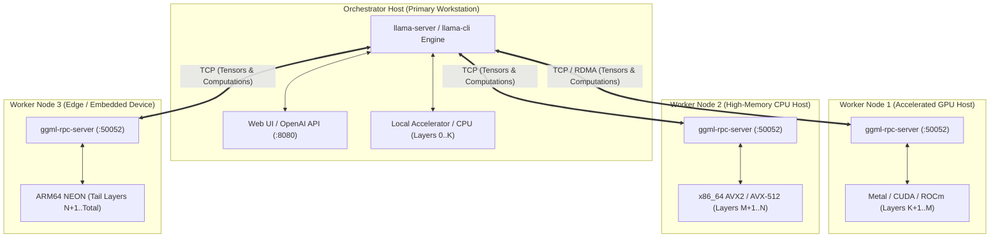

# Universal Distributed Tensor Splitting & RPC Manual
### Exhaustive Cross-Platform Guide: macOS, Windows, Linux Distros, and Embedded Systems

---

## 1. Executive Architecture: How GGML RPC Operates

`llama.cpp` implements native distributed tensor computation via the **GGML RPC Protocol** (Protocol Version 8). Rather than requiring identical datacenter GPUs interconnected with proprietary NVLink bridges, GGML RPC enables **heterogeneous memory and compute pooling** across arbitrary consumer hardware connected via local network interfaces (Ethernet, Thunderbolt, or Wi-Fi).



### Key Technical Characteristics:
1. **Model Storage Centralization**: Only the **Orchestrator node** requires the `.gguf` model file on disk. Remote worker nodes do not need a copy of the model file unless local disk caching (`-c`) is activated.
2. **Buffer Allocation Protocol**:
   - The Orchestrator queries each worker's available memory via `RPC_CMD_GET_DEVICE_MEMORY`.
   - The Orchestrator plans layer allocations and commands workers to allocate backend memory chunks (`RPC_CMD_ALLOC_BUFFER`).
3. **Execution Pipeline**:
   - For each inference step, the Orchestrator evaluates the computation graph.
   - Tensors offloaded to remote devices are executed by remote compute kernels, and activation tensors are communicated back over TCP.

---

## 2. Memory Sizing & Cluster Math

To calculate how much model weight and context memory your combined fleet can support:

$$\text{Total Pooled RAM} = \sum_{i=1}^{N} \text{Usable RAM}_i$$

$$\text{Max Model Footprint} \le \text{Total Pooled RAM} - (\text{KV Cache Size} + \text{Activation Graph Overhead} + \text{OS Overhead})$$

### Reference Memory Budgets:
- **7B Model (Q4_K_M)**: ~4.5 GB weights + 1.0 GB context (4K) = **5.5 GB minimum cluster RAM**.
- **14B Model (Q4_K_M)**: ~9.0 GB weights + 1.5 GB context (4K) = **10.5 GB minimum cluster RAM**.
- **32B Model (Q4_K_M)**: ~20.5 GB weights + 3.5 GB context (4K) = **24.0 GB minimum cluster RAM**.
- **70B Model (IQ2_XS)**: ~26.0 GB weights + 6.0 GB context (4K) = **32.0 GB minimum cluster RAM**.
- **70B Model (Q4_K_M)**: ~43.0 GB weights + 8.0 GB context (4K) = **51.0 GB minimum cluster RAM**.

---

## 3. Exhaustive Per-Platform Setup Guides

---

### Platform A: macOS (Apple Silicon M1/M2/M3/M4 & Intel)

macOS systems benefit from Apple Silicon unified memory architectures and high-bandwidth Metal GPU acceleration.

#### 1. System Prerequisites
Open Terminal and install Apple Developer Tools and Homebrew:
```bash
xcode-select --install
/bin/bash -c "$(curl -fsSL https://raw.githubusercontent.com/Homebrew/install/HEAD/install.sh)"
brew install git cmake ninja
```

#### 2. Building `llama.cpp` with Metal & RPC Support
```bash
git clone --recursive https://github.com/ggml-org/llama.cpp.git
cd llama.cpp

cmake -B build-metal -G Ninja \
  -DCMAKE_BUILD_TYPE=Release \
  -DGGML_METAL=ON \
  -DGGML_RPC=ON

cmake --build build-metal --config Release -j$(sysctl -n hw.ncpu)
```

#### 3. Running as an RPC Worker Node
```bash
./build-metal/bin/ggml-rpc-server -H 0.0.0.0 -p 50052 -c
```
- `-H 0.0.0.0`: Listen on all network interfaces.
- `-p 50052`: Default RPC listening port.
- `-c`: Enables local disk caching under `~/Library/Caches/rpc/`. Subsequent launches avoid re-transferring gigabytes of tensors over the network.

#### 4. Running 24/7 as a Background Daemon (`launchd`)
Create `~/Library/LaunchAgents/com.offlinecluster.rpc.plist`:
```xml
<?xml version="1.0" encoding="UTF-8"?>
<!DOCTYPE plist PUBLIC "-//Apple//DTD PLIST 1.0//EN" "http://www.apple.com/DTDs/PropertyList-1.0.dtd">
<plist version="1.0">
<dict>
    <key>Label</key>
    <string>com.offlinecluster.rpc</string>
    <key>ProgramArguments</key>
    <array>
        <string>/usr/local/bin/ggml-rpc-server</string>
        <string>-H</string>
        <string>0.0.0.0</string>
        <string>-p</string>
        <string>50052</string>
        <string>-c</string>
    </array>
    <key>RunAtLoad</key>
    <true/>
    <key>KeepAlive</key>
    <true/>
</dict>
</plist>
```
Load the daemon:
```bash
launchctl load ~/Library/LaunchAgents/com.offlinecluster.rpc.plist
```

#### 5. High-Speed Thunderbolt 4 Bridge (Mac-to-Mac)
Connecting two Macs with a Thunderbolt 4 / USB4 cable creates a dedicated 20–40 Gbps point-to-point network:
1. Open **System Settings -> Network -> Thunderbolt Bridge**.
2. Assign static IPs (e.g. Host 1: `10.0.0.1`, Host 2: `10.0.0.2`, Subnet Mask `255.255.255.0`).
3. Use the Thunderbolt IP in your `--rpc` arguments to achieve sub-millisecond tensor transport.

---

### Platform B: Linux (All Major Distributions)

Linux provides maximum control over NUMA memory nodes, CPU core pinning, and network socket tuning.

#### 1. Distribution Package Installation

##### Debian / Ubuntu / Linux Mint / Pop!_OS:
```bash
sudo apt-get update
sudo apt-get install -y build-essential cmake git libopenblas-dev libcurl4-openssl-dev pkg-config
```

##### Arch Linux / Manjaro / EndeavourOS:
```bash
sudo pacman -Syu --needed base-devel cmake git openblas
```

##### Fedora / RHEL 9 / CentOS Stream / Rocky Linux / AlmaLinux:
```bash
sudo dnf install -y gcc-c++ make cmake git openblas-devel libcurl-devel
```

##### openSUSE (Tumbleweed & Leap):
```bash
sudo zypper install -y -t pattern devel_basis
sudo zypper in -y cmake git openblas-devel libcurl-devel
```

##### Alpine Linux (musl libc / Minimal Containers):
```bash
apk add --no-cache build-base cmake git linux-headers openblas-dev curl-dev
```

#### 2. Compiling with RPC Support
```bash
git clone --recursive https://github.com/ggml-org/llama.cpp.git
cd llama.cpp

# For CPU-only workers (AVX2 / OpenMP)
cmake -B build-linux \
  -DCMAKE_BUILD_TYPE=Release \
  -DGGML_RPC=ON \
  -DGGML_OPENMP=ON

# For NVIDIA GPU workers (CUDA + RPC)
# cmake -B build-linux -DCMAKE_BUILD_TYPE=Release -DGGML_CUDA=ON -DGGML_RPC=ON

cmake --build build-linux -j$(nproc)
```

#### 3. Linux Firewall Configuration
```bash
# UFW (Ubuntu / Debian)
sudo ufw allow 50052/tcp

# Firewalld (Fedora / RHEL / CentOS)
sudo firewall-cmd --permanent --add-port=50052/tcp
sudo firewall-cmd --reload
```

#### 4. Running 24/7 as a Background Service (`systemd`)
Create `/etc/systemd/system/ggml-rpc.service`:
```ini
[Unit]
Description=GGML RPC Worker Node Service
After=network.target

[Service]
Type=simple
User=nobody
ExecStart=/usr/local/bin/ggml-rpc-server -H 0.0.0.0 -p 50052 -c
Restart=always
RestartSec=3
LimitNOFILE=65535

[Install]
WantedBy=multi-user.target
```
Enable and start the service:
```bash
sudo systemctl daemon-reload
sudo systemctl enable --now ggml-rpc
sudo systemctl status ggml-rpc
```

---

### Platform C: Windows 10 & Windows 11

#### Option 1: Native Visual Studio 2022 (MSVC)
1. Install [Visual Studio 2022 Community](https://visualstudio.microsoft.com/downloads/) with **Desktop development with C++** enabled.
2. Install [CMake](https://cmake.org/download/) and [Git for Windows](https://git-scm.com/download/win).
3. Open **Developer Command Prompt for VS 2022**:
```cmd
git clone --recursive https://github.com/ggml-org/llama.cpp.git
cd llama.cpp
cmake -B build-win -G "Visual Studio 17 2022" -A x64 -DGGML_RPC=ON -DGGML_OPENMP=ON
cmake --build build-win --config Release -j %NUMBER_OF_PROCESSORS%
```

#### Option 2: Lightweight w64devkit (Portable / Zero Visual Studio Bloat)
1. Download `w64devkit` from [GitHub Releases](https://github.com/skeeto/w64devkit/releases).
2. Extract to `C:\w64devkit` and launch `w64devkit.exe`.
3. In the shell:
```bash
git clone --recursive https://github.com/ggml-org/llama.cpp.git
cd llama.cpp
make GGML_RPC=1 -j$(nproc)
```

#### Option 3: Windows Subsystem for Linux (WSL2)
1. In PowerShell: `wsl --install -d Ubuntu`
2. Inside the Ubuntu shell, follow the [Linux Debian/Ubuntu](#debian--ubuntu--linux-mint--pop_os) instructions above.

#### Windows Defender Firewall Rule
Open an Administrative PowerShell prompt:
```powershell
New-NetFirewallRule -DisplayName "GGML-RPC-Server-50052" `
  -Direction Inbound `
  -LocalPort 50052 `
  -Protocol TCP `
  -Action Allow
```

#### Running as a Background Windows Service (via NSSM)
1. Download [NSSM (Non-Sucking Service Manager)](https://nssm.cc/download).
2. In Administrator PowerShell:
```powershell
nssm install GGML-RPC-Server "C:\llama.cpp\build-win\bin\Release\ggml-rpc-server.exe" "-H 0.0.0.0 -p 50052 -c"
nssm start GGML-RPC-Server
```

---

### Platform D: Embedded, Single-Board Computers & Edge Devices

#### 1. Raspberry Pi 4 / Raspberry Pi 5 (Raspberry Pi OS 64-bit)
```bash
sudo apt update && sudo apt install -y build-essential cmake git libopenblas-dev
git clone --recursive https://github.com/ggml-org/llama.cpp.git
cd llama.cpp
cmake -B build-rpi -DCMAKE_BUILD_TYPE=Release -DGGML_RPC=ON
cmake --build build-rpi -j$(nproc)
./build-rpi/bin/ggml-rpc-server -H 0.0.0.0 -p 50052 -c
```

#### 2. NVIDIA Jetson (Nano / Xavier / Orin)
```bash
git clone --recursive https://github.com/ggml-org/llama.cpp.git
cd llama.cpp
cmake -B build-jetson -DCMAKE_BUILD_TYPE=Release -DGGML_CUDA=ON -DGGML_RPC=ON
cmake --build build-jetson -j$(nproc)
./build-jetson/bin/ggml-rpc-server -H 0.0.0.0 -p 50052 -c
```

#### 3. Nintendo Switch (Horizon OS / libnx via LlamaNX)
The Nintendo Switch runs a custom ARM64 build of `llama.cpp` using devkitPro `libnx`:
- **Physical Memory Boundary**: ~3,280 MB available to application in Title Override mode.
- **Memory Chunking Safeguard**: `ggml_backend_cpu_buffer_type_get_max_size` is set to `512 MB` to prevent single-allocation heap failure.
- **Launch Mode**:
  1. Boot Switch into Atmosphere CFW.
  2. Launch **LlamaNX** homebrew via **Title Override** (Hold `R` while launching an installed game title).
  3. Press **`[X]`** on the Joy-Con to enter **Distributed RPC Server Node Mode**.
  4. The Switch listens on TCP port `50052`.

---

## 4. Launching the Multi-Node Cluster

Once all worker nodes are running `ggml-rpc-server` on port `50052`:

### 1. Identify Node IP Addresses
- Workstation Orchestrator: `192.168.1.100` (Local)
- Worker Node 1 (GPU Node): `192.168.1.101`
- Worker Node 2 (CPU Node): `192.168.1.102`
- Worker Node 3 (CPU Node): `192.168.1.103`
- Worker Node 4 (Edge Node): `192.168.1.104`

### 2. Start Orchestrator in HTTP Server Mode (OpenAI Compatible)
```bash
./llama-server \
  -m models/qwen2.5-32b-instruct-q4_k_m.gguf \
  --host 0.0.0.0 \
  --port 8080 \
  --rpc 192.168.1.101:50052,192.168.1.102:50052,192.168.1.103:50052,192.168.1.104:50052 \
  -ngl 99 \
  --tensor-split 16,16,8,8,4 \
  -c 4096
```

### Parameter Reference:
- `--rpc <endpoints>`: Comma-separated list of `IP:Port` worker nodes.
- `-ngl 99`: Offloads all possible transformer layers across the cluster.
- `--tensor-split <proportions>`: Fractions determining how many tensor weights and KV cache blocks are placed on each node.
- `-c 4096`: Allocated context window.

---

## 5. Network Optimization & Low-Latency Tuning

In distributed inference, token generation speed is directly constrained by network latency:

$$\text{Latency per token} \approx \text{Compute Execution Time} + \sum_{i=1}^{\text{Nodes}} \text{Network Round Trip Time}_i$$

### Optimization Checklist:
1. **Prefer Ethernet or Thunderbolt over Wi-Fi**:
   - 2.4 GHz Wi-Fi: 20–60 ms jitter (drops throughput to ~1–3 t/s).
   - 5 GHz Wi-Fi (Wi-Fi 6): 2–6 ms latency (~8–14 t/s).
   - Gigabit Ethernet / Thunderbolt Bridge: $<0.2\text{ ms}$ latency (Full native throughput).
2. **Disable Nagle's Algorithm (`TCP_NODELAY`)**:
   Built into `llama.cpp`'s RPC transport to prevent buffering small activation packets.
3. **Kernel Socket Queue Expansion**:
   ```bash
   # Linux:
   sudo sysctl -w net.core.rmem_max=16777216
   sudo sysctl -w net.core.wmem_max=16777216
   sudo sysctl -w net.ipv4.tcp_window_scaling=1
   ```
