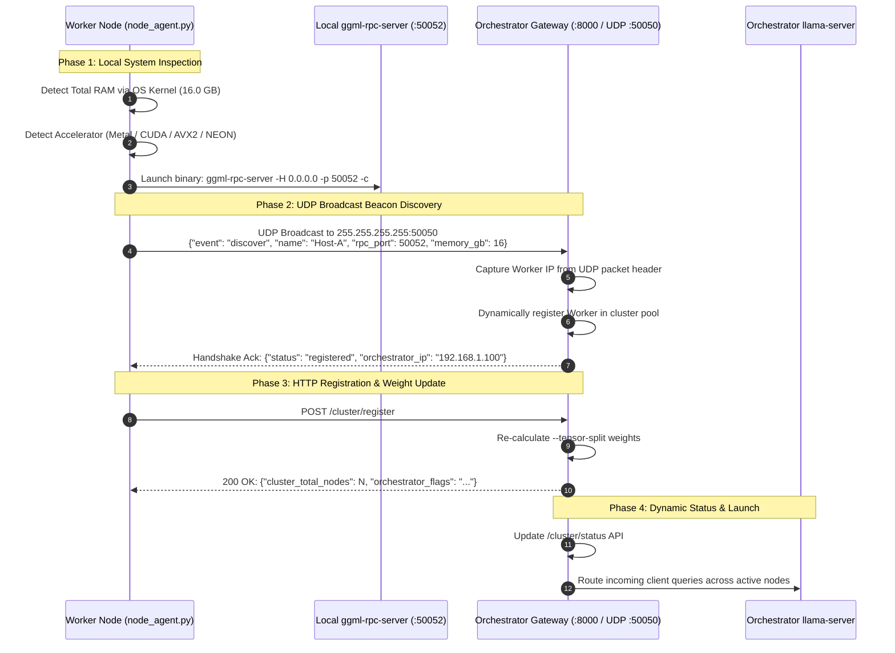

# Portable Worker Auto-Discovery & Zero-Config Clustering
### Technical Architecture & Operational Guide for Single-Script Node Deployment

---

## 1. The Operational Challenge: Manual IP & Tensor-Split Burden

In traditional distributed machine learning setups, adding a new node to a cluster is tedious and error-prone:
1. You must log into the worker machine, run `ipconfig` or `ifconfig`, and note the assigned DHCP IP.
2. If the router re-leases a new IP address, the entire cluster configuration breaks.
3. You must inspect physical RAM, manually calculate proportional `--tensor-split` weights, and reconstruct a multi-node command line:
   ```bash
   ./llama-server --rpc 192.168.1.101:50052,192.168.1.102:50052,192.168.1.103:50052 ...
   ```
4. If a machine disconnects, the command must be manually rewritten and restarted.

**Offline-AI-Cluster** eliminates this overhead through **Zero-Configuration Portable Auto-Discovery**.

---

## 2. The Solution: The "Single Binary + Single Script" Pattern

To add **any** machine to the cluster (a workstation, a secondary laptop, a Linux server, or a handheld console):
You only need **two portable files**:
1. The pre-compiled executable: `ggml-rpc-server` (or `.exe` on Windows).
2. The zero-dependency Python script: `scripts/node_agent.py`.

```text
Any Machine (macOS / Windows / Linux)
├── ggml-rpc-server   (Pre-compiled executable)
└── node_agent.py     (Zero-dependency agent script)
```

Run one command:
```bash
python node_agent.py
```

The node self-inspects, launches the backend, discovers the Orchestrator on the local network, and joins the compute pool in **under 2 seconds**.

---

## 3. How It Actually Works Under the Hood

The discovery and connection sequence consists of 4 automated phases:



### Phase 1: Native Kernel Memory Inspection (Zero-Dependency)
`node_agent.py` determines exact physical memory without third-party Python packages (`psutil`):
- **Windows**: Queries the Win32 API kernel structure `GlobalMemoryStatusEx` via `ctypes`.
- **macOS**: Queries the Darwin kernel via `sysctl -n hw.memsize`.
- **Linux**: Reads `/proc/meminfo` -> `MemTotal`.
- **Accelerator Detection**: Probes for Apple Silicon Metal, `nvidia-smi` CUDA interfaces, or ARM64 NEON.

### Phase 2: Local Subnet UDP Broadcast Beacon
The worker constructs a discovery packet and broadcasts it to `255.255.255.255` on UDP port `50050`.
The Orchestrator's Gateway (`scripts/gateway.py`) runs a background listener on port `50050`. When the packet arrives:
- The Gateway inspects the packet's source IP address from the network layer socket (`addr[0]`).
- It extracts the node's declared RAM and accelerator capabilities.
- It dynamically adds the node to the in-memory `ACTIVE_REGISTRY`.
- It transmits an acknowledgement datagram back to the worker containing the Orchestrator's IP and HTTP port.

### Phase 3: Proportional Tensor-Split Calculation
Whenever a node registers or leaves, the Gateway automatically computes the proportional weight matrix:

$$\text{Weight}_i = \text{round}\left(\text{RAM}_i\right)$$

$$\text{Flags} = \text{--rpc } \text{IP}_1:\text{Port}_1, \dots, \text{IP}_N:\text{Port}_N \quad \text{--tensor-split } W_1, \dots, W_N$$

You can query the live generated flags at any time via:
```bash
curl http://localhost:8000/cluster/status
```

Output:
```json
{
  "gateway_status": "operational",
  "healthy_node_count": 4,
  "total_pooled_ram_gb": 44.0,
  "generated_launch_command": "./llama-server -m models/qwen.gguf --rpc 192.168.1.101:50052,192.168.1.102:50052,192.168.1.103:50052 --tensor-split 16,16,8,4 -ngl 99"
}
```

---

## 4. How Embedded & Non-Python Devices Hook In

Devices that do not have Python installed (such as the **Nintendo Switch running LlamaNX** or bare-metal embedded Linux boards) hook into the exact same auto-discovery architecture:

### 1. UDP Datagram Emission
On boot or entry into Mode `[X]`, the embedded device emits a single UDP broadcast datagram to port `50050`:
```json
{
  "event": "discover",
  "name": "Nintendo-Switch",
  "rpc_port": 50052,
  "memory_gb": 3.2,
  "accelerator": "arm64_neon"
}
```

### 2. Immediate Dynamic Incorporation
The Orchestrator Gateway receives the datagram, registers the embedded device's IP, and includes its memory proportion into the `--tensor-split` configuration automatically.

---

## 5. Security & Isolation in Air-Gapped Networks

- **No Public WAN Exposure**: The UDP beacon broadcasts strictly on the local broadcast address (`255.255.255.255` or subnet broadcast `192.168.1.255`). Broadcast packets are dropped by default by all internet routers and cannot escape the local LAN.
- **RPC Protocol Security**: The GGML RPC protocol version 8 does not implement cryptographic encryption or authentication. Therefore, the cluster is designed to operate **exclusively within trusted air-gapped subnets, isolated VLANs, or encrypted WireGuard / Tailscale mesh overlays**.
